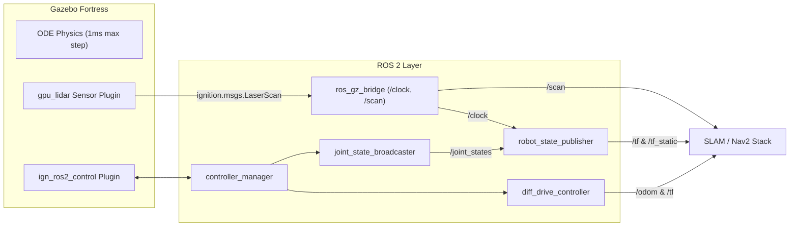

# 03_diff_drive_robot: Autonomous 2-Wheel Differential Drive Mobile Robot

A complete simulated differential-drive mobile robot stack developed for **ROS 2 Humble** and **Gazebo Fortress (Ignition 6.18.0)**, featuring `ros2_control`, precision odometry, 360° 2D LiDAR integration, and readiness for SLAM Toolbox and Nav2 autonomous navigation.

---

## 1. Robot Kinematics & Specifications

| Component | Parameter | Value | Notes |
| :--- | :--- | :--- | :--- |
| **Chassis** | Dimensions ($L \times W \times H$) | $0.40 \times 0.25 \times 0.10\,\text{m}$ | Centered at $z=+0.05\,\text{m}$ relative to `base_link` |
| **Mass** | Total Weight | $6.30\,\text{kg}$ | Chassis: $5.0\,\text{kg}$, Wheels: $2 \times 0.5\,\text{kg}$, Caster: $0.2\,\text{kg}$, LiDAR: $0.1\,\text{kg}$ |
| **Wheel Radius ($r$)** | `left/right_wheel_link` | **$0.05\,\text{m}$** ($50\,\text{mm}$) | Cylinder length: $0.04\,\text{m}$ |
| **Wheel Separation ($d$)** | Track Width | **$0.30\,\text{m}$** ($300\,\text{mm}$) | Symmetrical offsets: $y_L = +0.15\,\text{m}, y_R = -0.15\,\text{m}$ |
| **Caster Ball** | Passive Omnidirectional Support | Radius $0.05\,\text{m}$ | Mounted at $x = +0.15\,\text{m}, z = 0.0\,\text{m}$, low-friction contact ($\mu = 0.001$) |
| **LiDAR Sensor** | `laser_link` | Mounted on chassis | Offset $xyz=(+0.10, 0.0, 0.125)\,\text{m}$ relative to `base_link` |

---

## 2. Differential Drive Kinematic Equations

For a differential drive robot with wheel radius $r$ and track width $d$:

### Forward Kinematics (Wheel Speeds to Body Velocities)
Given left wheel angular velocity $\omega_L$ and right wheel angular velocity $\omega_R$:
$$v_x = \frac{r}{2} (\omega_R + \omega_L)$$
$$\omega_z = \frac{r}{d} (\omega_R - \omega_L)$$

### Inverse Kinematics (Body Velocities to Wheel Speeds)
Given commanded linear velocity $v_x$ and angular velocity $\omega_z$:
$$\omega_L = \frac{v_x - \frac{d}{2} \omega_z}{r}$$
$$\omega_R = \frac{v_x + \frac{d}{2} \omega_z}{r}$$

---

## 3. Link Hierarchy & TF2 Transformation Tree

```mermaid
flowchart TD
    odom["odom (Odometry World Frame)"]
    bf["base_footprint (Ground Projection Frame, z=0)"]
    bl["base_link (Chassis Frame, z=0.05m)"]
    lw["left_wheel_link"]
    rw["right_wheel_link"]
    cw["caster_wheel_link"]
    ll["laser_link (2D LiDAR Frame)"]

    odom -->|/tf dynamic (diff_drive_controller)| bf
    bf -->|/tf_static (robot_state_publisher)| bl
    bl -->|/tf dynamic (robot_state_publisher)| lw
    bl -->|/tf dynamic (robot_state_publisher)| rw
    bl -->|/tf_static (robot_state_publisher)| cw
    bl -->|/tf_static (robot_state_publisher)| ll
```

---

## 4. 2D LiDAR Sensor Specifications

- **Sensor Type**: Gazebo Fortress `gpu_lidar` plugin
- **Mount Position**: $x = +0.10\,\text{m}, y = 0.0\,\text{m}, z = +0.125\,\text{m}$ relative to `base_link` ($0.175\,\text{m}$ above ground)
- **Field of View (FOV)**: $360.0^\circ$ ($[-\pi, +\pi]$ rad)
- **Beam Samples**: $720$ samples ($0.5^\circ$ angular resolution)
- **Update Frequency**: $10\,\text{Hz}$
- **Detection Range**: $0.10\,\text{m}$ to $10.0\,\text{m}$
- **ROS 2 Topic**: `/scan` (`sensor_msgs/msg/LaserScan`)
- **Frame ID**: `laser_link`
- **Bridge**: `ros_gz_bridge parameter_bridge` (`/scan@sensor_msgs/msg/LaserScan[ignition.msgs.LaserScan`)

---

## 5. Software Architecture



---

## 6. How to Build & Run

### 1. Build Package
```bash
cd /media/bumble/DATA_DISK/robotics/projects/03_diff_drive_robot
colcon build --symlink-install
source install/setup.bash
```

### 2. Launch in RViz2 (with joint sliders)
```bash
ros2 launch diff_drive_description display.launch.py
```

### 3. Launch Gazebo Fortress Simulation
```bash
# GUI Mode with Arena World & Controllers
ros2 launch diff_drive_description gazebo.launch.py

# Headless Server Mode (low CPU)
ros2 launch diff_drive_description gazebo.launch.py headless:=true

# Gazebo + RViz2 Combined
ros2 launch diff_drive_description gazebo.launch.py rviz:=true
```

### 4. Teleoperate / Send Velocity Commands
```bash
# Drive Forward (0.5 m/s)
ros2 topic pub --once /cmd_vel geometry_msgs/msg/Twist "{linear: {x: 0.5, y: 0.0, z: 0.0}, angular: {x: 0.0, y: 0.0, z: 0.0}}"

# Rotate Counter-Clockwise (1.0 rad/s)
ros2 topic pub --once /cmd_vel geometry_msgs/msg/Twist "{linear: {x: 0.0, y: 0.0, z: 0.0}, angular: {x: 0.0, y: 0.0, z: 1.0}}"

# Emergency Stop
ros2 topic pub --once /cmd_vel geometry_msgs/msg/Twist "{linear: {x: 0.0, y: 0.0, z: 0.0}, angular: {x: 0.0, y: 0.0, z: 0.0}}"
```

---

## 7. Automated Test Suites

All tests are simulation-time calibrated and run headless without manual intervention:

```bash
# Phase 1: Physics, Spawning, and Ground Contact Stability
python3 tests/test_phase1_physics.py

# Phase 2: ros2_control Hardware Interface & Controller Activation
python3 tests/test_phase2_ros2_control.py

# Phase 3: Comprehensive 9-Maneuver Motion Test Suite
python3 tests/test_phase3_motion.py

# Phase 4: Precision Odometry & TF2 Verification
python3 tests/test_phase4_odometry.py

# Phase 5: 2D LiDAR Integration & Scan Geometry Verification
python3 tests/test_phase5_lidar.py

# Baseline Structural Checks
python3 test_robot.py
python3 test_extra.py
```
