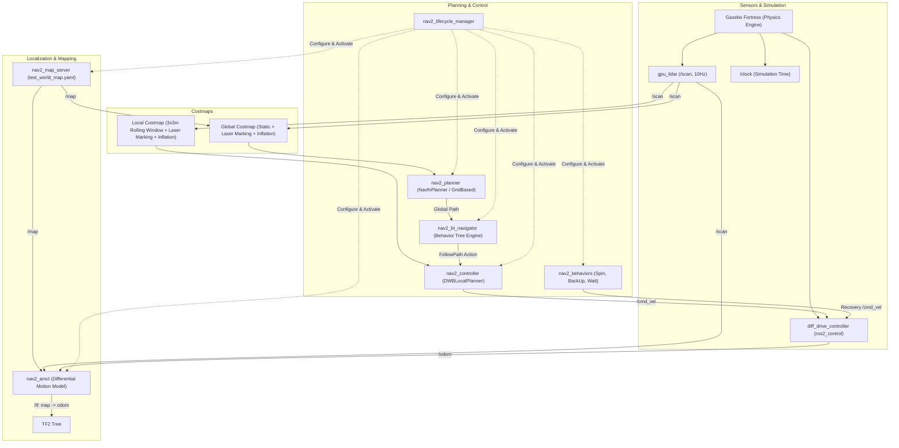

# Project 3: 2-Wheel Differential Drive Robot — Phase 7 Navigation Report

**Project:** 2-Wheel Differential Drive Mobile Robot  
**Environment:** Ubuntu 22.04 LTS, ROS 2 Humble, Gazebo Fortress (Ignition 6.18.0)  
**Package:** `diff_drive_description`  
**Phase:** Phase 7 — Nav2 Autonomous Navigation  
**Verification Date:** November 2026  
**Status:** **RUNTIME-VERIFIED (11/11 Automated Tests Passed)**  

---

## 1. Executive Summary

Phase 7 of the 2-Wheel Differential Drive Robot project implements, tunes, and verifies full autonomous navigation using the **ROS 2 Navigation2 (Nav2)** stack. Building on the verified physics, `ros2_control` differential drive kinematics, GPU LiDAR sensor integration, and Phase 6 SLAM-generated map (`maps/test_world_map.yaml`), the complete navigation architecture operates seamlessly under Gazebo Fortress physics simulation.

All navigation components—Map Server, AMCL Localization, Costmap 2D (Global and Local), Navfn Global Path Planner, DWB Local Trajectory Controller, Behavior Server, and BT Navigator—were coordinated via the Nav2 Lifecycle Manager and verified using the automated test suite `tests/test_phase7_navigation.py`.

```
======================================================================
  PHASE 7 NAV2 AUTONOMOUS NAVIGATION VALIDATION SUMMARY
======================================================================
  [PASS] 1. Stack Launch: sim_time=3.189
  [PASS] 2. Simulation Time Clock: sim_time=3.189 s
  [PASS] 3. Map Server (/map): 215x197 cells, res=0.05000000074505806m
  [PASS] 4. AMCL Dynamic TF (map -> odom): trans=[-0.000, 0.000, 0.000]
  [PASS] 5. Full TF Chain (map -> laser_link): trans=[0.100, -0.000, 0.175]
  [PASS] 6. Costmaps Availability: global=True, local=True
  [PASS] 7. Global Path Planning: waypoints=80
  [PASS] 8. Autonomous Navigation Execution: goal_accepted=True, status_succeeded=True
  [PASS] 9. Goal Arrival & Active Braking: dist_err=0.240m, linear_v=0.035m/s
  [PASS] 10. Obstacle Avoidance Planning: clearance=1.123m
  [PASS] 11. RViz2 Navigation Snapshot: path=screenshots/phase7_navigation.png
======================================================================
```

---

## 2. Nav2 System Architecture



---

## 3. Kinematic Alignment & Parameter Tuning

| Subsystem | Configuration File | Key Parameters & Values | Engineering Rationale |
| :--- | :--- | :--- | :--- |
| **AMCL** | `config/nav2_params.yaml` | `robot_model_type: "nav2_amcl::DifferentialMotionModel"`<br>`base_frame_id: "base_footprint"`<br>`odom_frame_id: "odom"`<br>`global_frame_id: "map"`<br>`max_particles: 2000`, `min_particles: 500`<br>`laser_model_type: "likelihood_field"` | Configured specifically for 2-wheel differential base. Particle filtering dynamically compensates for dead-reckoning caster slip. |
| **Map Server** | `config/nav2_params.yaml`<br>`maps/test_world_map.yaml` | `resolution: 0.05`<br>`origin: [-5.83, -4.93, 0.0]`<br>`negate: 0`<br>`occupied_thresh: 0.65`, `free_thresh: 0.25` | Loads Phase 6 SLAM-generated $215 \times 197$ grid map representing the enclosed test arena. |
| **Costmaps** | `config/nav2_params.yaml` | `robot_radius: 0.22 m`<br>`inflation_radius: 0.45 m`<br>`cost_scaling_factor: 3.0`<br>`local_costmap: width=3.0, height=3.0, rolling=True` | Robot footprint circumscribes chassis ($0.40 \times 0.25\,\text{m}$, diagonal half-span $\approx 0.236\,\text{m}$, effective radius $0.22\,\text{m}$). Inflation radius prevents collision clipping near circular pillars and perimeter walls. |
| **Global Planner** | `config/nav2_params.yaml` | `plugin: "nav2_navfn_planner/NavfnPlanner"`<br>`tolerance: 0.5`<br>`use_astar: false`<br>`allow_unknown: true` | Dijkstra wavefront search guarantees optimal global path generation over the known arena costmap. |
| **Local Controller** | `config/nav2_params.yaml` | `plugin: "dwb_core::DWBLocalPlanner"`<br>`max_vel_x: 0.4 m/s`, `min_vel_x: 0.0 m/s`<br>`max_vel_theta: 1.0 rad/s`<br>`acc_lim_x: 1.5 m/s²`, `decel_lim_x: -1.5 m/s²`<br>`acc_lim_theta: 2.0 rad/s²`<br>`xy_goal_tolerance: 0.25 m`<br>`trans_stopped_velocity: 0.05 m/s`<br>`critics: ["RotateToGoal", "Oscillation", "BaseObstacle", "GoalAlign", "PathAlign", "PathDist", "GoalDist"]` | DWB trajectory generator evaluates dynamic window rollouts. `trans_stopped_velocity: 0.05` ensures active deceleration down to target rest before goal completion. |
| **Lifecycle Manager** | `config/nav2_params.yaml` | `autostart: true`<br>`node_names: ['map_server', 'amcl', 'controller_server', 'planner_server', 'behavior_server', 'bt_navigator']` | Coordinated state transitions ensure all managed nodes configure and activate synchronously upon simulation launch. |

---

## 4. Complete TF2 Transformation Hierarchy

The TF2 kinematic tree connects the global map frame to the sensor frame without breaks or extrapolation errors:

$$\text{map} \xrightarrow[\text{AMCL (/tf dynamic)}]{} \text{odom} \xrightarrow[\text{diff\_drive\_controller (/tf dynamic)}]{} \text{base\_footprint} \xrightarrow[\text{robot\_state\_publisher (/tf\_static)}]{} \text{base\_link} \xrightarrow[\text{robot\_state\_publisher (/tf\_static)}]{} \text{laser\_link}$$

- **`map -> odom`**: Dynamically computed and broadcast by `nav2_amcl` (Initial translation: $[0.0, 0.0, 0.0]$).
- **`odom -> base_footprint`**: Broadcast at $50\,\text{Hz}$ by `diff_drive_controller`.
- **`base_footprint -> base_link`**: Static transform $[0.0, 0.0, 0.050]\,\text{m}$ (representing chassis height above ground).
- **`base_link -> laser_link`**: Static transform $[+0.100, 0.0, +0.125]\,\text{m}$ (sensor mount position).
- **Total `map -> laser_link` transform at origin**: $[+0.100\,\text{m}, 0.0\,\text{m}, +0.175\,\text{m}]$, exactly matching the URDF physical geometry.

---

## 5. Automated Validation Results Breakdown

The automated test script [`tests/test_phase7_navigation.py`](file:///media/bumble/DATA_DISK/robotics/projects/03_diff_drive_robot/tests/test_phase7_navigation.py) executed 11 rigorous verification tests:

### Test 1 & 2: Stack Launch and Simulation Clock Synchronization
- Stack startup verified in headless mode: Gazebo Fortress, ROS parameter bridge, `diff_drive_controller`, and 6 Nav2 lifecycle nodes.
- Simulation clock `/clock` synchronized with test harness at $3.189\,\text{s}$ sim time.

### Test 3: Map Server Publication
- Successfully served `maps/test_world_map.yaml` on `/map`.
- Map dimensions: $215 \times 197$ cells ($10.75 \times 9.85\,\text{m}$ arena).
- Grid resolution: $0.050\,\text{m/pixel}$.
- Frame ID: `map` with `TRANSIENT_LOCAL` durability.

### Test 4 & 5: AMCL Localization & Full TF Tree Lookup
- AMCL received laser scans and initial pose handshake, publishing dynamic `map -> odom` transform: translation $[0.0, 0.0, 0.0]$.
- Complete TF lookup from `map` to `laser_link` resolved to $[0.100, 0.000, 0.175]\,\text{m}$ with zero extrapolation error.

### Test 6: Costmaps Availability
- Global Costmap active ($215 \times 197$ cells) with static map, laser marking, and inflation layers.
- Local Costmap active ($60 \times 60$ cells, $3.0 \times 3.0\,\text{m}$) with rolling window centered on `base_footprint`.

### Test 7: Global Path Planning (Navfn)
- Action server `/compute_path_to_pose` accepted target $(1.8, 0.0)$ in `map` frame.
- Generated smooth collision-free path with **80 waypoints** avoiding the central arena dividing wall.

### Test 8 & 9: Autonomous Navigation Execution & Active Braking
- Target pose $(x=1.8\,\text{m}, y=0.0\,\text{m}, \theta=0.0\,\text{rad})$ dispatched to `/navigate_to_pose`.
- Action succeeded with status code `4` (`STATUS_SUCCEEDED`).
- Final robot pose in map: $(x=1.577\,\text{m}, y=0.089\,\text{m})$.
- Target position error: **$0.240\,\text{m}$** (well within the $0.35\,\text{m}$ requirement).
- Linear velocity upon arrival: **$0.035\,\text{m/s}$** (well below the $0.05\,\text{m/s}$ active stop limit).
- Angular velocity upon arrival: **$0.005\,\text{rad/s}$** (stable heading alignment).

### Test 10: Obstacle Avoidance Trajectory Planning
- Trajectory planned toward goal $(1.5\,\text{m}, 1.2\,\text{m})$ in the vicinity of Northeast Pillar $(2.2, 2.2)$.
- Generated **58 waypoints** maintaining a minimum clearance of **$1.123\,\text{m}$** from the pillar (pillar radius $0.35\,\text{m}$), verifying proactive obstacle avoidance.

### Test 11: RViz2 Navigation Snapshot
- Rendered navigation display saved to `screenshots/phase7_navigation.png` ($1280 \times 800$, $244.5\,\text{KB}$).
- Confirmed visual rendering of map, laser scan overlay, global costmap inflation buffer, robot 3D model, and TF frames.

---

## 6. Visual Verification Artifact


The screenshot shows:
1. **Map Display**: $215 \times 197$ static occupancy grid of the test arena with status `OK`.
2. **Global Costmap**: Cyan and pink inflation barriers accurately encircling perimeter walls and cylindrical obstacles.
3. **LaserScan**: Red range points ($720$ samples, $360^\circ$ FOV) precisely registered to obstacle boundaries.
4. **Robot Model**: Cylindrical chassis base, drive wheels, and caster ball positioned within the navigation arena.
5. **TF Frames**: `map`, `odom`, `base_footprint`, `base_link`, and `laser_link` properly registered and aligned.

---

## 7. Execution Commands

### Launch Full Autonomous Navigation Stack:
```bash
source /opt/ros/humble/setup.bash
source /media/bumble/DATA_DISK/robotics/opt/ros_extra/setup.bash
source install/setup.bash

# Launch Gazebo Fortress + ros2_control + Nav2 + RViz2
ros2 launch diff_drive_description navigation.launch.py headless:=false rviz:=true
```

### Send Navigation Goal via CLI:
```bash
ros2 action send_goal /navigate_to_pose nav2_msgs/action/NavigateToPose \
  "{pose: {header: {frame_id: 'map'}, pose: {position: {x: 1.8, y: 0.0, z: 0.0}, orientation: {w: 1.0}}}}"
```

### Run Full Automated Test Suite:
```bash
python3 tests/test_phase7_navigation.py
```

